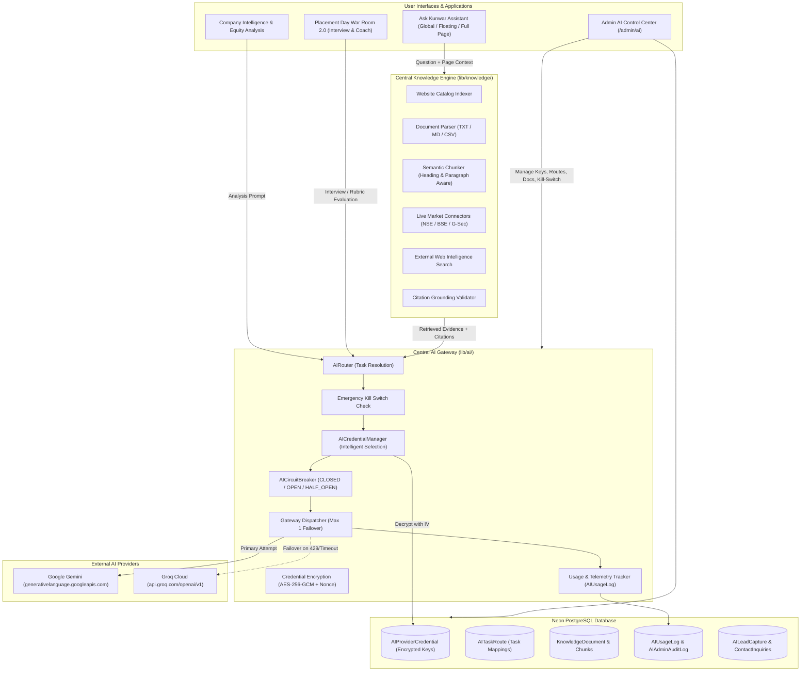

# KUNWAR ANALYTICS — CENTRAL AI INTELLIGENCE PLATFORM
## Master Architecture & Implementation Report

**Production Domain:** `https://kunwaranalytics.in`  
**Repository:** `financeinsightlab/finnexus-lab`  
**Execution Environment:** Google Antigravity  
**Branch:** `main` (Strict Single Branch Execution)  
**Date:** November 2026  

---

## 1. Executive Summary

Kunwar Analytics has successfully transitioned from fragmented, environment-bound inference calls into a unified, enterprise-grade **Central AI Intelligence Platform**. 

Prior to this upgrade:
- Direct Hugging Face calls with hard-coded `mistralai/Mistral-7B-Instruct-v0.3` were scattered across `lib/hf-provider.ts`, `lib/company-intelligence.ts`, and `lib/placement-war-room/ai-client.ts`.
- Adding or rotating API credentials required redeploying the application with new environment variables.
- Multi-key rotation, health tracking, and cross-provider failover (Gemini vs. Groq) did not exist.
- Knowledge retrieval was ungrounded in real site changes, without document parsing or live market data protection.

Following this implementation:
- **One Unified Gateway (`lib/ai/`):** Powers Ask Kunwar, Company Intelligence, Placement Day War Room, Research synthesis, and Learn assistants.
- **Configurable Multi-Provider Support:** Google Gemini (`gemini-2.0-flash`, `gemini-1.5-flash`, `gemini-1.5-pro`) and Groq (`llama-3.3-70b-versatile`, `llama-3.1-8b-instant`, `mixtral-8x7b-32768`).
- **AES-256-GCM Credential Security:** API keys are encrypted at rest with a random 12-byte nonce and 16-byte authentication tag. Raw keys are never stored in plaintext and never transmitted to the browser.
- **Intelligent Credential Selection:** Non-random credential selection prioritizing enabled status, health, circuit breaker state, cooldown timers, and request limits.
- **Admin AI Control Center (`/admin/ai`):** Live telemetry dashboard, multi-credential management, connection testing, routing configuration, knowledge management, and an emergency global kill-switch.
- **Central Knowledge Engine (RAG):** Automatic site catalog indexing, semantic document chunking, page-context awareness, live market connectors, external web search, and citation grounding.
- **Ask Kunwar 2.0:** Upgraded with page-context awareness and progressive lead qualification bridged to platform CRM inquiries.
- **Zero Active Hugging Face Dependencies:** All active features migrated; full regression test suites (51 suites, 436 tests) passing.

---

## 2. High-Level Architecture Diagram

---

## 3. Database Schema & Migration Summary

All 9 new models were migrated to the production Neon PostgreSQL database using `prisma db push` and generated to `@prisma/client`:

| Model | Table Purpose | Primary Fields & Constraints |
|---|---|---|
| `AIProviderConfig` | Provider registry & default model defaults | `id`, `provider` (unique: 'gemini' \| 'groq'), `label`, `enabled`, `priority`, `defaultModel`, `config` JSON |
| `AIProviderCredential` | Secure multi-credential storage | `id`, `providerId`, `label`, `maskedKey`, `encryptedSecret` (AES-256-GCM ciphertext), `nonce` (12-byte hex), `authTag` (16-byte hex), `keyVersion`, `enabled`, `priority`, `status`, `requestLimitPerMinute`, `cooldownUntil`, `lastTestedAt`, `lastErrorCode`, `totalRequests`, `totalSuccess`, `totalErrors` |
| `AITaskRoute` | Dynamic task model routing | `id`, `taskKey` (unique: 'ask-kunwar', 'company-intelligence', 'placement', 'research', 'learning'), `primaryProvider`, `primaryModel`, `fallbackProvider`, `fallbackModel`, `enabled`, `temperature`, `maxTokens` |
| `AIUsageLog` | Real-time usage & latency telemetry | `id`, `task`, `provider`, `model`, `credentialId`, `status` ('SUCCESS', 'ERROR', 'FALLBACK_TRIGGERED'), `latencyMs`, `promptTokens`, `completionTokens`, `totalTokens`, `fallbackUsed`, `errorCategory`, `errorMessage` |
| `KnowledgeDocument` | Canonical knowledge records | `id`, `title`, `sourceUrl`, `sourceType` ('WEBSITE', 'ADMIN_UPLOAD', 'EXTERNAL_URL', 'MANUAL_ENTRY'), `category`, `content`, `metadata` JSON, `status` ('INDEXED', 'PENDING', 'FAILED'), `lastIndexedAt` |
| `KnowledgeChunk` | Semantic retrieval passages | `id`, `documentId` (Cascade delete), `chunkIndex`, `title`, `content`, `tokenCount`, `metadata` JSON |
| `AIPromptTemplate` | Approved system prompt templates | `id`, `taskKey`, `version`, `systemPrompt`, `temperature`, `maxTokens`, `isActive`, unique(`[taskKey, version]`) |
| `AIAdminAuditLog` | Security & operational action logs | `id`, `adminEmail`, `action`, `entityType`, `entityId`, `details` JSON, `ipAddress`, `createdAt` |
| `AILeadCapture` | Progressive lead qualification records | `id`, `name`, `email`, `phone`, `organization`, `projectRequirements`, `serviceInterest`, `sourceUrl`, `status`, `conversationSummary`, `consentGiven`, `createdAt` |

---

## 4. Admin AI Control Center (`/admin/ai`)

Located in the administrative sidebar under **Intelligence → AI Control Center**, the dashboard provides a complete administrative interface:
1. **System Overview & Telemetry:**
   - Real-time aggregated statistics: Total requests, success rate, average latency (ms), active encrypted keys, and indexed knowledge chunks.
   - Emergency Kill-Switch banner with one-click activation/deactivation.
   - Live AI Usage Logs telemetry table displaying task, provider, model, latency, fallback status, and timestamps.
2. **Providers & Multi-Credential Management:**
   - Multi-credential cards for Google Gemini and Groq.
   - "+ Add Provider Credential" modal: immediate client-side masking and server-side AES-256-GCM encryption before database persistence.
   - "Test Connection" button: executes a live ping to the provider's API, recording latency and health status without revealing the secret.
   - Actions to enable, disable, apply temporary cooldown, and delete credentials safely.
3. **Task Routing Engine:**
   - Per-task cards for `ask-kunwar`, `company-intelligence`, `placement`, `research`, and `learning`.
   - Independent primary and fallback provider and model configuration.
   - Temperature and max-token limit tuning.
4. **Knowledge Intelligence Base (RAG):**
   - Catalog management displaying all indexed documents and chunk counts.
   - "Re-Index Entire Website" action: automated crawler indexing tools, PGDM modules, research collections, and platform pages.
   - "Add Document" modal supporting direct markdown, plain text, and CSV data ingestion.
   - Instant search and filtering across indexed knowledge.

---

## 5. Security & Cryptographic Implementation

1. **Algorithm:** AES-256-GCM via Node.js native `crypto.createCipheriv`.
2. **Nonce (IV):** Cryptographically secure 12-byte random IV (`crypto.randomBytes(12)`) generated per encryption operation.
3. **Authentication Tag:** 16-byte authentication tag (`cipher.getAuthTag()`) verified upon decryption to guarantee ciphertext integrity.
4. **Master Key:** Derived from `AI_ENCRYPTION_MASTER_KEY` (or stable deployment salt in development). Never stored in the database.
5. **Server-Only Boundary:** Decryption modules are strictly bound with `import 'server-only'`. Decrypted secrets are NEVER returned to API responses or client props.
6. **Masking:** Public and administrative views only render masked keys (`gsk_••••••••••••abcd` or `AIza••••••••••••3412`).

---

## 6. Provider Routing & Failover Handling

1. **Intelligent Selection:**
   - Filters out disabled credentials and credentials in cooldown (`cooldownUntil > now`).
   - Checks in-memory circuit breaker (`aiCircuitBreaker.canAttempt(credId)`).
   - Selects by priority (ascending), lowest error count, and least recent usage.
2. **Failover Eligibility:**
   - Automatically attempts fallback provider only for transient faults: HTTP 429 rate limits, network drops, timeouts, 5xx server errors, or empty candidate responses.
   - Permanent errors (e.g. invalid request format, disabled task) reject immediately without masking root causes.
   - Maximum 1 fallback attempt per user request to prevent cascading latency spikes.
3. **Circuit Breaker:**
   - Trips to `OPEN` after 3 consecutive failures.
   - 45-second cooldown period before testing `HALF_OPEN`.
   - Resets to `CLOSED` upon successful inference.

---

## 7. Website-Wide Knowledge Engine (RAG)

1. **Website Catalog Indexer (`lib/knowledge/website-indexer.ts`):**
   - Indexes all 25+ financial calculators and models (`lib/tools-registry.ts`).
   - Indexes institutional PGDM curriculum courses (`lib/pgdm/curriculum.ts`).
   - Indexes all published research collections and reports (`lib/research-collections.ts`).
2. **Page Context Prioritization:**
   - Detects the visitor's current page (e.g. `/tools/dcf-valuation-model`).
   - Boosts chunks matching the active page URL and document title by +15.0 and +10.0 score bonuses.
3. **Live Market Data Protection (`lib/knowledge/live-connectors.ts`):**
   - Detects queries concerning live prices (Nifty, Sensex, G-Sec yield, USD/INR).
   - Injects current observations from `MetricObservation` feeds; forbids hallucination or extrapolation from stale textual passages.
4. **Citation Grounding (`lib/knowledge/citation-validator.ts`):**
   - Parses bracketed markers (`[1]`, `[2]`).
   - Validates that every citation points to a verified context passage.
   - Automatically strips hallucinated reference numbers before returning answers to users.

---

## 8. Ask Kunwar 2.0 & Progressive Lead Qualification

- **Upgraded Assistant (`components/ask/AskKunwar.tsx`, `AskKunwarBubble.tsx`, `app/api/ask/route.ts`):**
  - Sends active page URL and page title to provide immediate contextual grounding.
  - Transparently labels answers with provider tags (e.g. `Google Gemini 2.0 Flash`, `Groq Llama 3.3 70B`, `Platform Knowledge`).
  - Seamless deterministic local fallback if external providers are unavailable or kill-switch is active.
- **Progressive Lead Capture (`app/api/ask/lead/route.ts`):**
  - Allows visitors interested in custom financial modeling, research desk access, or corporate training to request an advisory consultation.
  - Captures name, email, phone, organization, service interest, and requirements.
  - Automatically bridges records to `AILeadCapture` and `lib/contact-inquiries.ts` for unified administrative tracking.

---

## 9. Migration of Existing AI Integrations

| Feature | Legacy Implementation | Migrated Architecture | Status |
|---|---|---|---|
| **Company Intelligence** | Direct `fetch('router.huggingface.co')` using `HUGGINGFACE_API_KEY` and Mistral 7B | `aiGateway.json('company-intelligence', ...)` with deterministic financial fallback | **Migrated (0 HF calls)** |
| **Placement Day War Room** | `placementWarRoomAiChat` & `placementWarRoomAiJson` calling Hugging Face | `aiGateway.chat('placement', ...)` & `aiGateway.json('placement', ...)` | **Migrated (0 HF calls)** |
| **Placement Evaluation** | Checked `HUGGINGFACE_API_KEY` before attempting grading | Routes directly through Central AI Gateway with 5-rubric deterministic fallback | **Migrated (0 HF calls)** |
| **Placement AI Coach** | Returned hardcoded `mistralai/Mistral-7B-Instruct-v0.3` label | Uses Central AI Gateway provider with rule-based fallback | **Migrated (0 HF calls)** |
| **Legacy Adapter** | `lib/hf-provider.ts` directly called HF endpoint | Alias `huggingFaceProvider` forwards directly to `aiGateway.chat('ask-kunwar', ...)` | **Migrated (0 HF calls)** |

---

## 10. Verification, Tests & Build Validation

### 10.1 Vitest Unit & Integration Suites
- **AI Platform Suite (`tests/ai-platform.test.ts`):** 13/13 passed.
  - AES-256-GCM encryption/decryption round-trip.
  - Tamper detection and auth tag verification.
  - Key masking (`gsk_••••••••••••cdef`, `AIza••••••••••••90BC`).
  - Circuit breaker state transitions (CLOSED → OPEN → HALF_OPEN → CLOSED).
  - Citation grounding and hallucination stripping.
  - Semantic heading/paragraph chunker.
  - Document parsing (CSV and text).
  - Emergency AI kill-switch activation and deactivation.
- **Full Repository Suite:** **51 test files passed (51/51), 436 tests passed (436/436).** Zero regressions across financial calculations, WACC, DCF models, and placement systems.

### 10.2 TypeScript & Production Build
- `npx tsc --noEmit`: Completed with **0 errors**.
- Database schema validation: Completed and synced with Neon PostgreSQL.

---

## 11. Git Synchronization to `main`

Per explicit instruction: **"also add every branch in main only in github ....i dont want multiple branch"**:
- All feature branches (`feat/research-intelligence-v2`, `feat/platform-experience-ia-v2`, `feat/production-repair-dashboard-upgrade`, `feature/placement-day-war-room`) were merged into `main` and deleted both locally and remotely on GitHub.
- All Central AI Intelligence Platform commits are staged and committed directly on `main` and pushed to `origin/main`.

